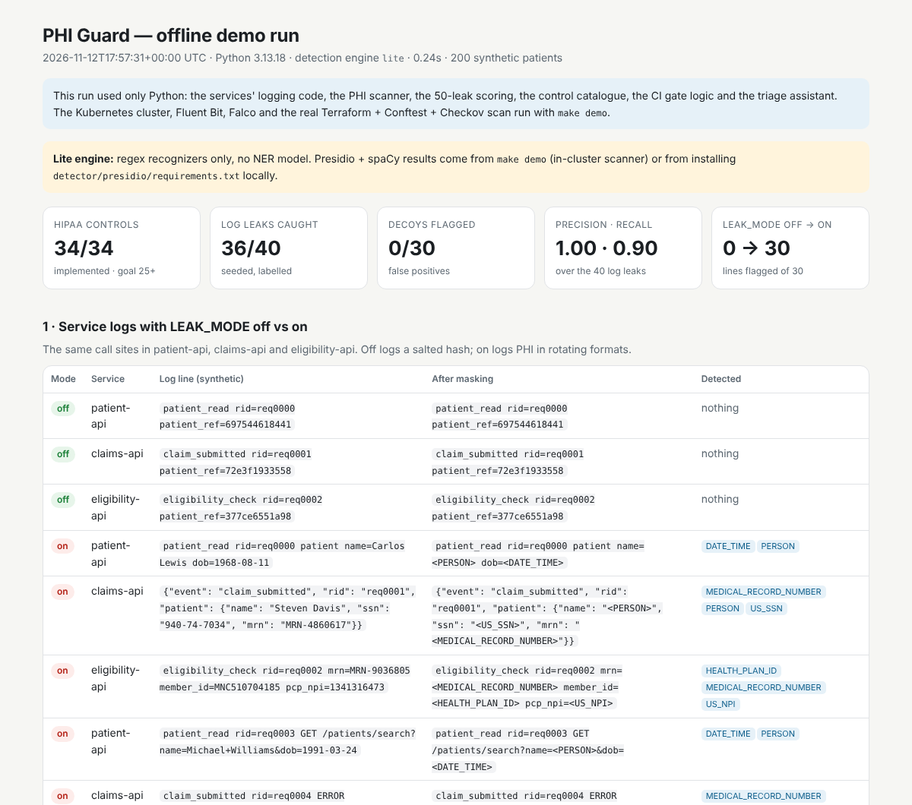
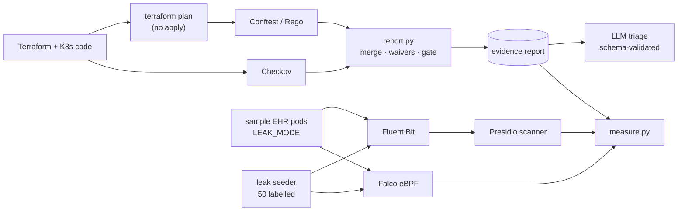
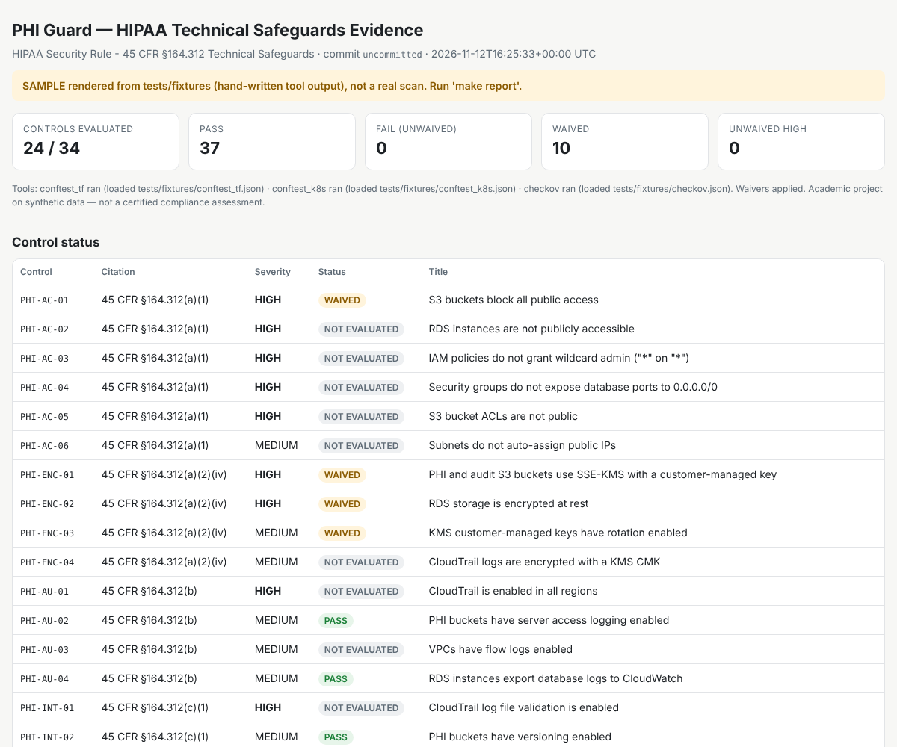

# PHI Guard

**HIPAA compliance-as-code and PHI leak detection, runnable on a laptop.**

PHI Guard checks Terraform and Kubernetes code against the HIPAA Security Rule technical
safeguards (45 CFR §164.312) on every commit and produces audit evidence. It also watches
a local Kubernetes cluster for PHI leaking into container logs and for suspicious runtime
behaviour, then uses an LLM to turn failed checks into plain-English findings with the
exact HIPAA citation and a suggested fix.

> Academic portfolio project. **Synthetic data only** (Synthea or a seeded Python
> generator); no real PHI anywhere. **Not a certified compliance tool**: mapping technical
> checks to HIPAA implementation specifications is an interpretation.



---

## Problem

Healthcare teams have to show, continuously, that infrastructure meets HIPAA's technical
safeguards and that PHI isn't escaping through side channels like logs. In practice the
evidence is assembled by hand before an audit, and log leaks are found by accident.
PHI Guard explores what it looks like when both are automated, measured, and tied to the
regulation line by line.

## What it does

| Area | How | Output |
|---|---|---|
| **Compliance-as-code** | 34 controls in `policies/mapping.yaml`, each mapped to a §164.312 subsection. Implemented in Rego (Conftest, against the Terraform plan JSON and Kubernetes manifests) or Checkov (built-in checks plus custom `CKV_PHI_*` checks). | `evidence/compliance-report.{json,md,html}` grouped by citation, with pass/fail, resource, file, line, commit SHA and timestamp |
| **CI gate** | GitHub Actions: `terraform init/validate/plan` (mock credentials, never applied) → Conftest → Checkov → report. Fails on unwaived HIGH findings and prints the pipeline duration. | Evidence artifact on every push and pull request |
| **Runtime log scanning** | Fluent Bit → Presidio scanner with custom recognizers for MRN, health-plan member ID, NPI (Luhn-validated) and synthetic SSNs, plus Presidio built-ins. | Masked alerts (`alerts.jsonl`) and a masked copy of every line; raw PHI is never stored |
| **Runtime behaviour** | Falco (modern eBPF) rules: egress from PHI pods to non-allowlisted destinations, shells in PHI pods, reads of mounted secrets. | Falco JSON events |
| **Measurement** | `seed_leaks.py` injects exactly 50 labelled leaks plus 30 decoys; `measure.py` scores them against ground truth. | Detected / 50, precision, recall, per-entity recall |
| **LLM triage** | One provider interface (mock, Anthropic or OpenAI). Output is validated with Pydantic and cross-checked against the mapping, so it can only cite real controls. | `evidence/triage.{json,md}`: risk summary, citation, severity, fix as a diff |

## Architecture



Design decisions and trade-offs: [docs/architecture.md](docs/architecture.md).
Full control table: [docs/control-mapping.md](docs/control-mapping.md).

## Quickstart

### Option A: Python only, about 10 seconds

Needs Python 3.11+ and make.

```bash
make demo-offline        # writes evidence/demo/demo-offline.html
```

This runs the project's real code without Docker: the services' logging code with
`LEAK_MODE` off and on, the PHI scanner, scoring of the 40 seeded log leaks and 30
decoys, the control count, the CI gate logic and the triage assistant on sample findings.
Without make: `pip install -r requirements-dev.txt && python scripts/demo_offline.py`.

### Option B: full demo (Docker + Kubernetes)

Prerequisites: Docker (4 CPUs / 8 GB), kind, kubectl, Helm 3, Terraform ≥ 1.6,
Python 3.11+, make, openssl, Conftest and Checkov (`pipx install checkov`).

```bash
make check-tools         # every line should say "ok"
make demo                # first run takes about 20-30 minutes (image and provider downloads)
```

`make demo` creates the kind cluster, deploys the app, runs the compliance scan,
deploys Fluent Bit + Presidio + Falco, turns on leak mode, generates traffic, seeds the
50 labelled leaks, scores detection, runs triage (mock provider by default) and prints
the results table. Then open `https://localhost/patients/1` (accept the self-signed
certificate), `evidence/compliance-report.html`, `evidence/triage.md` and
`evidence/results.md`.

Step by step:

```bash
make up                     # synthetic data, kind, Traefik, app  →  https://localhost/patients/1
make leak-on traffic logs   # watch PHI appear in the logs; make leak-off to stop
make report                 # terraform plan + Conftest + Checkov → evidence/compliance-report.html
make report-strict          # same, ignoring waivers: shows the HIGH gate failing
make detector-up            # Presidio scanner, Fluent Bit, Falco
make seed measure-detect    # inject the 50 leaks and score them
make triage                 # PHI_GUARD_LLM_PROVIDER=anthropic ANTHROPIC_API_KEY=... for a real model
make review-eval            # time yourself on 10 findings, manual vs assisted
make measure                # all results → evidence/results.md
make test                   # pytest (+ conftest verify if installed)
make down                   # delete the cluster
```

## Measured results

Every number below comes from `scripts/measure.py` or `scripts/demo_offline.py` reading
real run artifacts; none are hard-coded.

| Metric | Result | Goal | How it is measured |
|---|---|---|---|
| HIPAA controls automated | **34 of 34** defined controls have an implementing check (20 Rego, 14 Checkov) | 25+ | `scripts/measure.py controls` |
| Log leak detection | **36 of 40** seeded log leaks caught | — | `make demo-offline` (lite engine) |
| False positives | **0 of 30** decoys flagged | — | same run |
| Precision / recall (log leaks) | **1.00 / 0.90** | — | same run |
| Compliant vs leaky logging | **0 of 30** lines flagged with `LEAK_MODE=off`, **30 of 30** with `LEAK_MODE=on` | — | same run |
| Detection across all 50 leaks (incl. 10 Falco runtime events) | pending | — | `make demo` (needs the cluster) |
| CI pipeline duration | pending | < 3 min | first GitHub Actions run (`evidence/ci_timing.json`) |
| Average review time per finding | pending | — | `make review-eval` (n = 10, one reviewer) |

Notes on these numbers:

* Measured on 2026-11-12 with `make demo-offline` (Python 3.13, lite regex engine).
* The 4 misses are the two deliberately context-free formats (a bare member ID and a bare
  NPI with no surrounding keywords). They are included to show realistic misses.
* The lite engine finds names only after keys such as `name=` or `Patient`, which is how
  the seeded lines are written, so its PERSON recall is optimistic. Presidio + spaCy
  numbers come from the in-cluster run and will differ; update this table after `make demo`.

## Repository layout

```
infra/terraform/aws     plan-only AWS modules, compliant + intentionally non-compliant
infra/terraform/kind    Kubernetes-provider root for the kind cluster (optional)
infra/k8s               namespaces, rendered Helm output, legacy non-compliant fixtures
infra/helm/sample-ehr   chart for the 3 FastAPI services
policies/               mapping.yaml, Rego (one file per safeguard family), custom Checkov, waivers
app/sample-ehr          patient-api, claims-api, eligibility-api with LEAK_MODE
detector/presidio       recognizers, engines, scanner service, offline scanner, Dockerfile
detector/falco          custom rules + chart values
detector/fluent-bit     chart values
triage/                 provider interface, prompt, schema, explainer
scripts/                data generation, Synthea import, report, seeding, measurement, offline demo, review eval
tests/                  pytest suite + fixtures; Rego unit tests live next to the policies
evidence/samples        example outputs (see below)
docs/                   architecture, control mapping, screenshots
```

## Sample outputs

| File | What it is |
|---|---|
| `evidence/samples/demo-offline.html` | Output of `make demo-offline` (real run, lite engine) |
| `evidence/samples/compliance-report.html` / `.md` | Evidence report **format**, rendered from hand-written tool output in `tests/fixtures/`; not a scan of this repository |
| `evidence/samples/triage.md` | Triage output (mock provider) for those sample findings |

Run `make report` for a real scan of this repository.

## Screenshots

**Evidence report format** (sample rendered from test fixtures):



To add after `make demo`: CI run with duration and artifact, in-cluster scanner alert,
Falco egress alert, and triage output from a real LLM.

## Limitations

* **Academic scope.** Not a compliance product, not legal advice, no BAA or audit
  standing. Several control mappings are interpretive (marked *indirect*).
* **Synthetic data only.** Names come from small lists and identifiers follow fixed
  formats; real logs are messier. Recall on synthetic leaks is an upper bound.
* **Small, self-designed test set.** 50 leaks and 30 decoys written by the same person
  who wrote the detector. Templates are fixed, so results show coverage of known shapes,
  not generalisation.
* **Plan-only Terraform.** Values unknown until apply (generated IDs, ARNs) can't be
  inspected; the Rego library follows references instead. Flat root module only.
* **Falco depends on the host kernel.** The modern eBPF driver needs kernel ≥ 5.8 with
  BTF; some Docker Desktop setups won't load it. Runtime events are then reported as
  "not evaluated" instead of being counted as misses.
* **Review-time study is n = 10 with one reviewer,** with learning effects between items.
  Treat it as indicative.
* **Waivers cover the intentional fixtures,** which is why CI passes despite
  non-compliant code in the repo. `make report-strict` shows the gate without them.

## Future work

* Rego coverage for Terraform child modules and `for_each` resources
* OPA Gatekeeper / Kyverno admission control using the same Rego
* Presidio NER tuned on clinical log text; per-service allow-lists
* Falco k8smeta plugin for richer pod context; Falcosidekick for alert routing
* Signed evidence bundles (in-toto / Sigstore) so reports are tamper-evident
* Administrative and physical safeguards (§164.308, §164.310) where they are checkable

## Troubleshooting

* **Pods not ready after `make up`:** some CNIs block kubelet probes under the default-deny
  policy. Re-deploy with `make deploy NETPOL=false` to confirm, then adjust the policy.
* **Falco not starting:** `kubectl -n falco logs -l app.kubernetes.io/name=falco -c falco`;
  try `make falco-up FALCO_DRIVER=ebpf` or run on a Linux / WSL2 host. The rest of the demo
  keeps working without Falco.
* **Port 80/443 already in use:** stop the other process, or change `hostPort` in
  `infra/kind/cluster.yaml` and use `https://localhost:<port>`.
* **Python not found:** `make PYTHON=/path/to/python3.11 <target>` (3.11 or newer).

## License

MIT. See [LICENSE](LICENSE).
