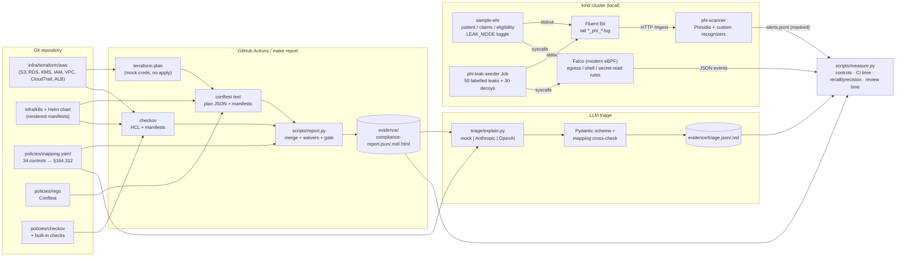

# Architecture

PHI Guard has two halves that share one control catalogue (`policies/mapping.yaml`):
**shift-left** checks that run on every commit, and **runtime** detection inside a
local Kubernetes cluster. An LLM triage step sits on top of the shift-left output.

## Shift-left: compliance-as-code

1. **Terraform plan, never apply.** `infra/terraform/aws` configures the AWS provider with
   dummy credentials and skips every validation that would call AWS, so `terraform plan`
   runs offline after `init`. Policy documents build ARNs from variables instead of
   resource attributes, which keeps them *known at plan time* so Rego can parse them.
2. **Two engines, one catalogue.** Each control in `mapping.yaml` names its engine.
   * **Conftest/Rego** evaluates the plan JSON (`resource_changes` for values,
     `configuration` for references like "this public-access-block points at that
     bucket") and the Kubernetes manifests in `--combine` mode (so cross-document rules
     such as "PHI namespace has a default-deny NetworkPolicy" work). Messages start with
     `[PHI-XXX-NN]`, which is how results are tied back to controls.
   * **Checkov** runs only the check IDs listed in the mapping: built-ins where they
     exist (`CKV_AWS_16`, `CKV_K8S_16`, …) and custom Python checks (`CKV_PHI_*`) where they
     don't.
3. **Evidence, not just violations.** `report.py` derives PASS rows for Rego controls
   from the in-scope resources (types/kinds + optional data-classification filter) that
   produced no failure; Checkov reports passes natively. Every row carries citation,
   severity, resource, file, line, commit SHA and timestamp.
4. **Waivers.** `policies/waivers.yaml` records risk acceptances (reason, owner, expiry).
   Waived failures stay visible but don't break the build; expired waivers stop applying.
   The intentionally non-compliant fixtures are waived so CI stays green, and
   `make report-strict` shows the HIGH-severity gate failing.

## Runtime: PHI leak detection

* **Log path.** Fluent Bit tails `/var/log/containers/*_phi_*.log` (only the PHI
  namespace), enriches with Kubernetes metadata and POSTs batches to the scanner.
  The scanner runs Presidio with spaCy NER for PERSON/DATE_TIME, Presidio built-ins for
  SSN/phone/email, and custom pattern recognizers for **MRN**, **health-plan member ID**,
  **NPI (Luhn-validated over the 80840 prefix)** and **synthetic 9xx SSNs** (Presidio's
  built-in SSN recognizer rejects 9xx area numbers by design, which would otherwise make
  every synthetic SSN invisible).
* **Policy layer.** A bare date is not PHI in a log line (every line has timestamps), so
  DATE_TIME is kept only near birth-date context or next to another identifier.
  Ambiguous shapes (7-digit numbers, `AAA#########`, 10-digit numbers) need a context
  word to cross the score threshold. These choices are what the decoy lines test.
* **No raw PHI at rest in the detector.** Alerts store a masked line and a SHA-256 of
  the original; `masked.jsonl` keeps a masked copy of every scanned line.
* **Syscall path.** Falco (modern eBPF driver) loads three self-contained rules scoped to
  `k8s.ns.name = phi`: outbound connects outside the kind pod/service CIDRs, shell
  execution, and reads under `/etc/phi-secrets` by anything other than the app.
* **Ground truth.** The seeder Job prints 40 PHI lines and 30 decoys, each ending in
  `rid=seed-<ID>`, then runs 10 runtime events whose argv contains `SEED-R<NN>` (egress
  goes to TEST-NET-3, 203.0.113.0/24, which is never routed). `measure.py` joins alerts
  to ground truth on those markers only after the run; detectors never see the labels.

## LLM triage

`triage/explain.py` sends one finding at a time with only that control's mapping entry
and a short source excerpt. The response must be JSON matching `TriageResult`
(Pydantic, `extra="forbid"`) and then pass `validate_against_mapping`: same control,
same finding, citation and severity copied exactly, fix in the control's format, and a
real unified diff. One retry with the validation error, then a deterministic fallback
marked `source: fallback`. Only IaC findings are sent; runtime PHI alerts never are.

## Why these boundaries

| Decision | Reason |
|---|---|
| Plan-only Terraform | Free, safe, reproducible; plan JSON is the same artifact a real pipeline would gate on. |
| Rego on plan JSON, Checkov on HCL | Rego sees resolved values and cross-resource references; Checkov brings a large maintained library. Overlap is deliberate defence-in-depth. |
| Conftest `--combine` for K8s | Needed for namespace-level rules; messages carry the file path so line numbers still resolve. |
| Lite engine fallback | Unit tests and CI run without spaCy. Results always record which engine produced them so lite and Presidio numbers are never mixed. |
| Traefik, not ingress-nginx | ingress-nginx was announced for retirement; the TLS-on-Ingress control is static and controller-agnostic. |
